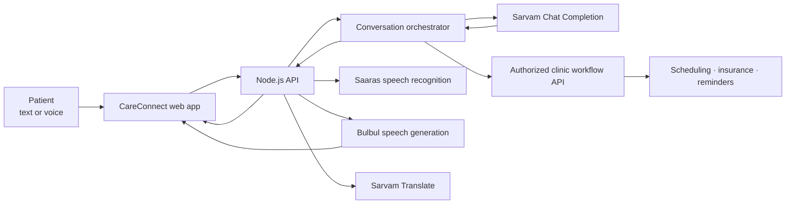

# ✳ CareConnect — Sarvam Healthcare Agent

### Care that speaks your language.

CareConnect is a multilingual healthcare administration assistant built with JavaScript and Sarvam AI. **The project supports eight languages: English, Hindi, Tamil, Telugu, Kannada, Marathi, Bengali, and Gujarati.** Patients can talk or type, receive a text response and (when enabled) a spoken reply, and get help navigating everyday care coordination. The project brings chat, voice, language support, and clinic workflow integration into one approachable web experience.

> **Created by Niraj Borole**<br>
> Department of Chemical Engineering · Indian Institute of Technology Kharagpur

---

## ✨ What the project does

- **Chat and voice intake:** Type a request or record a short message in the browser. Voice clips are transcribed, handled as a conversation, and answered in text with optional audio playback.
- **Eight supported conversation languages:** English, Hindi, Tamil, Telugu, Kannada, Marathi, Bengali, and Gujarati.
- **Appointment coordination:** Check available slots, request a booking, reschedule, or cancel through a connected clinic workflow service.
- **Insurance coordination:** Submit a cashless insurance verification request and check pre-authorization status through the configured provider integration.
- **Patient engagement:** Submit post-appointment follow-up, preventive care, and re-engagement campaigns. Reminders can be scheduled through the clinic workflow service.
- **Translation:** Translate text through Sarvam Translate.
- **Care team interface:** A responsive workspace includes patient assistant and campaign views, backend connection controls, and a movable Care Tools panel.

Sarvam powers conversation, speech recognition, speech generation, and translation. The clinic's trusted workflow service remains responsible for real patient records and operational actions. Without that integration configured, the assistant does not claim that an appointment, insurance check, or reminder has been completed.

## 🧭 How it fits together



### Technology

| Area | Implementation |
| --- | --- |
| Runtime | Node.js 20+ with ES modules |
| Server | Node.js built-in HTTP server |
| Sarvam integration | Official `sarvamai` JavaScript SDK |
| Chat | `sarvam-105b-conversations` with controlled tool calling |
| Speech | Saaras v4 transcription and Bulbul v3 synthesis |
| Translation | `sarvam-translate:v1` |
| Frontend | HTML, CSS, and browser JavaScript |
| Clinic operations | Separately configured workflow API |

## 🚀 Get started

### Requirements

- Node.js 20 or newer and npm
- A Sarvam API key
- A clinic workflow API if you want to perform real scheduling, insurance, reminder, or campaign actions

### 1. Configure environment

Copy `.env.example` to `.env` in the project root. Fill in `SARVAM_API_KEY` and create a long random value for `API_AUTH_TOKEN`. Keep `.env` private; Git ignores it.

```env
SARVAM_API_KEY=your_sarvam_api_key
API_AUTH_TOKEN=your_long_random_access_token
PORT=3000
WORKFLOW_API_URL=
WORKFLOW_API_TOKEN=
REQUEST_TIMEOUT_MS=45000
MAX_BODY_BYTES=8000000
```

`WORKFLOW_API_URL` and `WORKFLOW_API_TOKEN` are needed only when connecting a trusted clinic adapter. If you set a workflow URL, you must also set its token.

### 2. Install and start

```bash
npm install
npm start
```

For development with automatic restart:

```bash
npm run dev
```

Open **http://localhost:3000**. Select **Add API token**, then paste the value of `API_AUTH_TOKEN` from `.env`. The token is kept in the current browser tab's session storage. Check **http://localhost:3000/healthz** for the server health response.

### 3. Try a conversation

In the assistant, select a language and try:

> “I’d like to find a cardiology appointment tomorrow.”

You can type this or use the microphone. Chat replies include text and request a generated voice reply; the audio player appears below the assistant response when synthesis succeeds. For a real appointment lookup or booking, configure the clinic workflow service described below.

## 🔌 API overview

All API routes except `GET /healthz` require:

```http
Authorization: Bearer <API_AUTH_TOKEN>
```

| Method | Endpoint | Purpose |
| --- | --- | --- |
| `GET` | `/healthz` | Basic server health check |
| `GET` | `/api/v1/session` | Validate the browser's API token |
| `POST` | `/api/v1/chat` | Chat completion; set `voice_reply: true` to request audio |
| `POST` | `/api/v1/voice/webhook` | Handle transcript or base64 audio and return transcript, reply, and optional audio |
| `POST` | `/api/v1/translate` | Translate text using Sarvam Translate |
| `POST` | `/api/v1/campaigns/trigger` | Submit an approved campaign to the workflow service |

### Chat example

```bash
curl -X POST http://localhost:3000/api/v1/chat \
  -H "Authorization: Bearer YOUR_API_AUTH_TOKEN" \
  -H "Content-Type: application/json" \
  -d '{"message":"Help me find an appointment","language_code":"en-IN","voice_reply":true}'
```

For multi-turn requests, send `messages` as an array of `{ "role": "user" | "assistant", "content": "..." }` objects. The server supplies the system prompt and rejects caller-supplied system or tool messages. If speech generation fails, the response still includes the text reply.

### Voice input

`POST /api/v1/voice/webhook` accepts either `transcript` text or `audio_base64` plus `audio_mime_type`. Supported audio MIME types are WAV, MPEG, MP4, OGG, WebM, FLAC, and AAC. Audio is limited to 5 MB; browser recordings stop at 25 seconds. Set `language_code` to one of `en-IN`, `hi-IN`, `ta-IN`, `te-IN`, `kn-IN`, `mr-IN`, `bn-IN`, or `gu-IN`. Set `voice_reply: false` if you only want text.

This route is a request/response interface, not a live telephone media-stream bridge. A phone deployment needs a telephony integration, realtime audio transport, and signature verification at a trusted gateway.

## 🏥 Connect a clinic workflow service

Set `WORKFLOW_API_URL` to the root of a trusted adapter and `WORKFLOW_API_TOKEN` to its bearer token. The service sends JSON and expects JSON responses. Successful side effects must return `{ "ok": true }` so the assistant can accurately report completion.

| Method | Workflow route | Operation |
| --- | --- | --- |
| `GET` | `/v1/appointments/slots?department=...&date=YYYY-MM-DD` | Find available slots |
| `POST` | `/v1/appointments/book` | Book a confirmed appointment |
| `POST` | `/v1/appointments/reschedule` | Reschedule a confirmed appointment |
| `POST` | `/v1/appointments/cancel` | Cancel a confirmed appointment |
| `POST` | `/v1/insurance/cashless/verify` | Check cashless eligibility |
| `GET` | `/v1/insurance/preauth/status?claim_id=...` | Check pre-authorization status |
| `POST` | `/v1/reminders` | Schedule a confirmed reminder |
| `POST` | `/v1/campaigns/trigger` | Validate and submit a campaign |

The assistant requires explicit patient confirmation before booking, rescheduling, cancelling, or scheduling a reminder. The clinic adapter must independently verify patient identity, consent, permissions, eligibility, and contact preferences. Never treat model-generated tool arguments as authorization.

Campaign requests use `campaign_type` values `post_appointment_followup`, `preventive_care`, or `reengagement`, a list of opaque `patient_ids`, and a clinic-approved `message_template_id`. The clinic service must enforce consent, suppression lists, and send limits before contacting anyone.

## 🗂️ Project layout

```text
.
├── public/
│   ├── app.js                 # Browser interactions, chat, audio, campaigns
│   ├── index.html             # CareConnect interface
│   └── styles.css             # Responsive visual design
├── src/
│   ├── agent-orchestrator.js  # Conversation loop and workflow requests
│   ├── config.js              # Environment configuration and Sarvam client
│   ├── sarvam-client.js       # Chat, speech, and translation helpers
│   ├── server.js              # HTTP routes, auth, validation, static serving
│   ├── system-prompt.js       # Healthcare assistant behavior and guardrails
│   └── tools.js               # Structured workflow tools and validation
├── .env.example               # Environment variable names
├── chat.mjs                   # Minimal Sarvam chat example
└── package.json
```

## 🔐 Privacy and safety

- `.env` and `.env.*` are ignored by Git (except `.env.example`). Never commit API keys or patient data.
- The server does not log request bodies, transcripts, patient identifiers, insurance details, or upstream response bodies.
- Conversation history is supplied by the caller and is not persisted by this backend.
- Use opaque patient identifiers and send only information necessary for the requested workflow.
- The assistant is for administrative coordination, not diagnosis or medical advice. It directs emergency situations to emergency services.
- This project is an integration foundation; it is **not a claim of HIPAA compliance** or a complete healthcare deployment. Before processing real patient data, add an approved identity and access layer, protected state storage, audit trails, retention controls, managed secrets, TLS, monitoring, and organization-approved compliance review. Do not expose a shared API token to a public browser deployment.

## 📚 Sarvam references

- [JavaScript SDK](https://docs.sarvam.ai/api/getting-started/sdks)
- [Chat Completion](https://docs.sarvam.ai/api/api-guides-tutorials/chat-completion/overview)
- [Speech-to-Text](https://docs.sarvam.ai/api/api-guides-tutorials/speech-to-text/overview)
- [Bulbul text-to-speech](https://docs.sarvam.ai/api/getting-started/models/bulbul)
- [Text translation](https://docs.sarvam.ai/api/api-guides-tutorials/text-processing/translation)
- [Realtime STT guide](https://docs.sarvam.ai/api/api-guides-tutorials/speech-to-text/realtime-streaming)

---

<div align="center">
  <strong>CareConnect</strong><br>
  Built by Niraj Borole · Department of Chemical Engineering, IIT Kharagpur<br>
  <em>Thoughtful conversations. Clear next steps. Care across languages.</em>
</div>
